# UI/UX 評価記録

- [v3.2.0 — モバイル・タブレットのアイコンのみボタン](#v320--モバイルタブレットのアイコンのみボタン)
- [v3.1.0 — 第三者評価で見つかった問題の改善](#v310--第三者評価で見つかった問題の改善)
- [v3.0.0 — UI/UX 全面見直し](#v300--uiux-全面見直し)

## v3.2.0 — モバイル・タブレットのアイコンのみボタン

v3.1.0 の「残る課題」にあった「モバイルの表示切替と『⋮』がアイコンだけ」を、`CLAUDE.md` の手順で改善した。
調べると同じ問題はタブレット幅（641〜1180px）にもあり、表示切替・列・マスタ・タグ設定・⋮ がアイコンだけになっていた。
そのため、モバイル（390×844）とタブレット（900×700）の両方で撮って比べた（デスクトップは変更なし）。

### 1回目（5案 + 方向性の異なる2案）

| 案 | 内容 | 使 | わ | 直 | 汎 | 視 | 階 | 計 |
| --- | --- | --: | --: | --: | --: | --: | --: | --: |
| V1 | アイコンの下に小さなラベル（縦積み）＋「その他」 | 14 | 16 | 14 | 11 | 11 | 10 | 76 |
| V2 | 表示切替を1つのドロップダウン「リスト ▾」＋「メニュー」 | 14 | 15 | 14 | 13 | 11 | 11 | 78 |
| V3 | ラベル付きの全幅セグメント（専用の段）＋「その他」 | 15 | 17 | 15 | 12 | 12 | 9 | 80 |
| V4 | アイコン＋短いラベル（リスト/カード/予定）を横並び＋「メニュー」 | 15 | 16 | 14 | 12 | 12 | 11 | 80 |
| **V5** | 下部タブバー（ホーム/一覧/新規/メニュー）＋ラベル付き表示切替 | 17 | 17 | 16 | 12 | 13 | 13 | **88** |
| V6 | （別方向）アイコンは維持し、初回にコーチマークで説明 | 11 | 13 | 12 | 12 | 10 | 12 | 70 |
| V7 | （別方向）狭い画面では表示切替を減らす（カード行のみ＋「予定」ボタン） | 15 | 15 | 14 | 11 | 11 | 13 | 79 |

最高88点（90点未満）→ 2回目へ。分かったこと: 390px幅でヘッダーの「⋮」にラベルを付けると、右側のボタンが折り返して
ヘッダーが3〜4段になる（V1/V2/V3/V4/V7）。ラベルを付ける余地は、ヘッダーの外に置き場を作らないと生まれない。

モバイル: 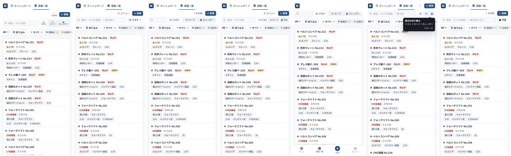

タブレット（上から V1〜V7）: 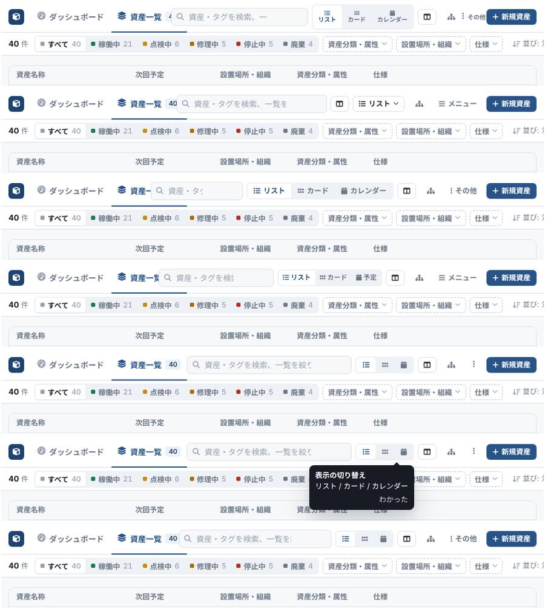

### 2回目（上位3案 V5/V3/V4 ＋ 組合せ4案）

| 案 | 内容 | 使 | わ | 直 | 汎 | 視 | 階 | 計 |
| --- | --- | --: | --: | --: | --: | --: | --: | --: |
| V5 | （1回目） | | | | | | | 88 |
| V3 | （1回目） | | | | | | | 80 |
| V4 | （1回目） | | | | | | | 80 |
| W1 | 下部タブバー＋表示切替は全幅ラベル行／タブレットは1段で短いラベル | 16 | 16 | 15 | 11 | 13 | 12 | 83 |
| **W2** | 下部タブバー＋検索と同じ行に短いラベルの表示切替／タブレットは1段で短いラベル | 18 | 17 | 16 | 10 | 13 | 14 | **88** |
| W3 | 上部のまま（タブ名短縮・その他/新規ラベル）＋短いラベル | 17 | 17 | 16 | 11 | 12 | 13 | 86 |
| W4 | 下部タブバー＋表示切替を「リスト ▾」に | 17 | 16 | 15 | 11 | 13 | 15 | 87 |

最高88点（90点未満）→ 3回目へ。タブレットでヘッダーを1段のままラベルを付けると、検索欄が使えないほど細くなり、
「資産一覧」の文字も隠れた（全組合せ案に共通する欠点）。

モバイル（左から V5, W1〜W4）: 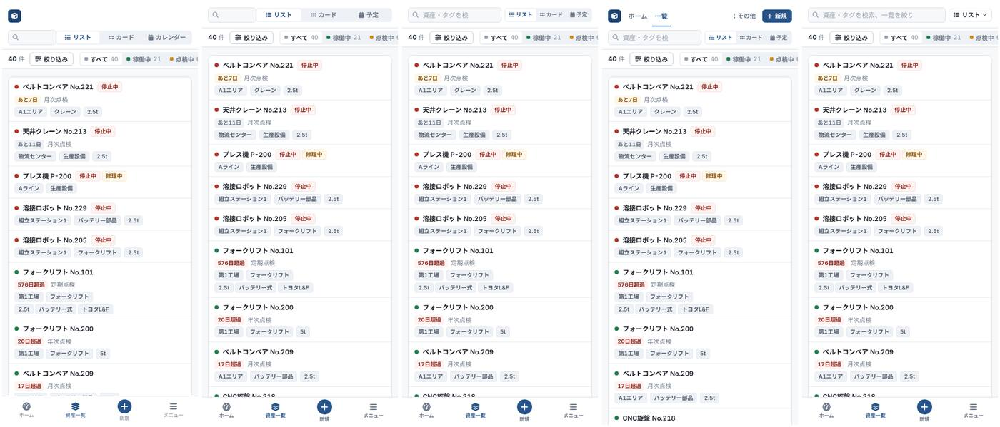

タブレット（上から W1〜W4）: 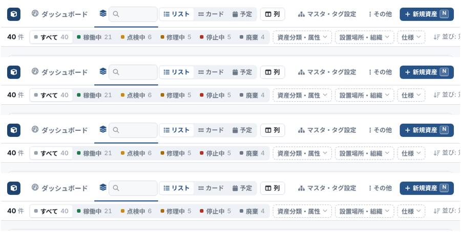

### 3回目（上位3案 V5/W2/W4 ＋ 組合せ4案）

| 案 | 内容 | 使 | わ | 直 | 汎 | 視 | 階 | 計 |
| --- | --- | --: | --: | --: | --: | --: | --: | --: |
| V5 | （1回目） | | | | | | | 88 |
| W2 | （2回目） | | | | | | | 88 |
| W4 | （2回目） | | | | | | | 87 |
| X1 | 下部タブバー＋1段ヘッダー（短いラベル）／タブレットは2段ヘッダーで正式ラベル | 19 | 18 | 17 | 15 | 13 | 14 | 96 |
| X2 | 下部タブバー＋1段ヘッダー／タブレットは1段のまま短いラベル | 18 | 17 | 15 | 12 | 13 | 14 | 89 |
| X3 | 上部のまま（タブ名短縮）＋タブレット2段ヘッダー | 16 | 16 | 14 | 14 | 12 | 12 | 84 |
| **X4** | X1＋「メニュー」は下から出るシート | 19 | 18 | 17 | 15 | 13 | 15 | **97** |

**決定: X4**（97点。3回目のため最高点の案に決定）。

モバイル（左から W2, X1〜X4）: 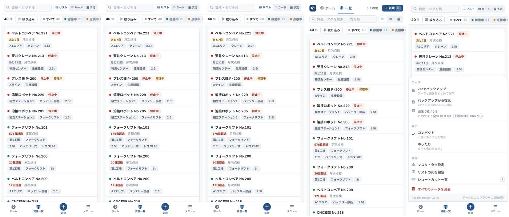

タブレット（上から X1〜X4）: 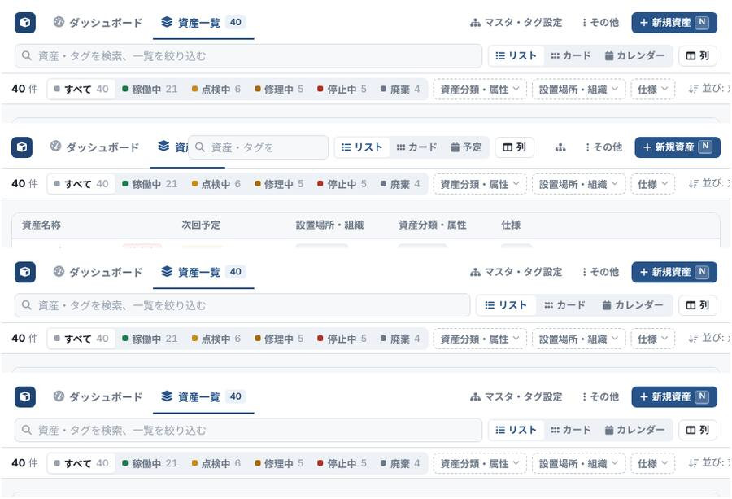

### 実装

- **モバイル（640px以下）**: ページ切替・新規・メニューを**下部タブバー**（ホーム / 資産一覧 / 新規 / メニュー）にラベル付きで置いた。
  ヘッダーは「検索＋表示切替（リスト / カード / 予定）」の1段だけになり、一覧の表示領域も増えた。
  「メニュー」は下から出るシートで開き、外側は暗くして、外側をタップしても閉じるだけにした（下の行を誤って開かない）
- **タブレット（641〜1180px）**: ヘッダーを2段（1段目=ページ切替と主要操作、2段目=検索・表示切替・列）にし、すべてのボタンにラベルを付けた
- **全幅**: 「⋮」を「⋮ その他」に変更

| モバイル（一覧 / ホーム / メニュー / カード） | タブレット |
| --- | --- |
| 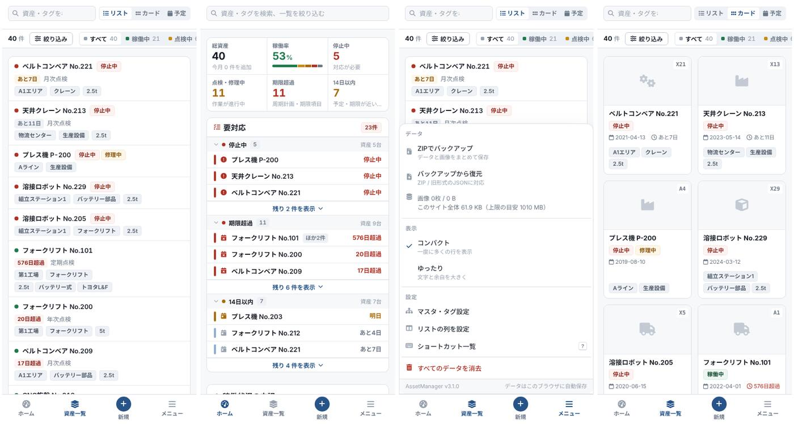 | 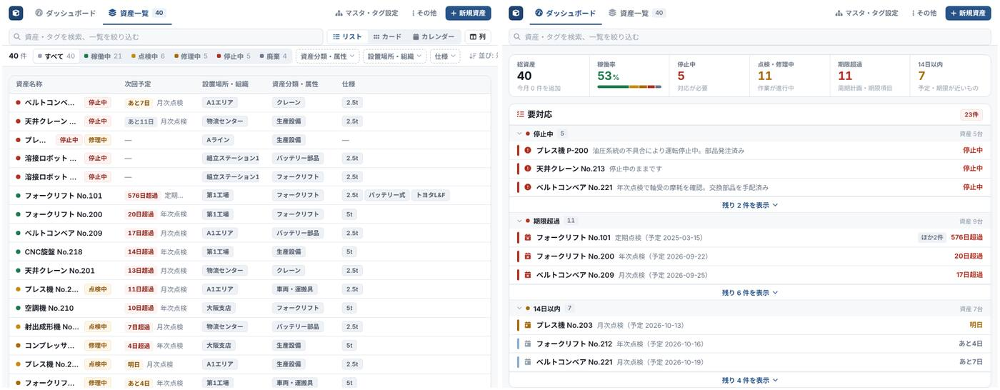 |

残る課題（今回の対象外）:

- モバイルのカレンダー表示が画面幅からはみ出す（木〜土の列が切れる）
- タブレット幅の一覧で資産名の列が狭く、名称が省略されやすい
- 同点のときの決め方が `CLAUDE.md` に無い（v3.1.0 から継続）

---

## v3.1.0 — 第三者評価で見つかった問題の改善

v3.0.0 の実装後の画面を改めて評価したところ（約79点）、次の問題が残っていた。
影響の大きいものを4項目にまとめ、`CLAUDE.md` の手順で案を比べて決めた。

| 問題 | 項目 |
| --- | --- |
| モバイルでマスタ別の絞り込みボタンが画面の右外に隠れ、スクロールできることも分からない | 1 |
| モバイルのヘッダーがアイコンだけのボタンになっている（設計方針7に反する） | 1 |
| ヘッダーに「この一覧の中を絞り込む」欄と「検索 Ctrl K」ボタンが並び、違いが分からない | 2 |
| 状態を行頭のドットと右端のステータス列で二重に表示している | 3 |
| 一覧の初期の並びが登録順で、期限超過・停止中が上に来ない | 3 |
| ダッシュボードの期限超過の上位3件を同じ資産（フォークリフト No.101）が占める | 4 |
| 要対応を各3件に絞る一方で、画面の下に約230pxの空白が残る | 4 |

v3.0.0 の評価記録で指摘された進め方の問題も、今回は次のように改めた。

- **モバイル幅（390×844）でも全案を撮って比較した**（v3.0.0 の比較シートはデスクトップ幅のみだった）
- 2回目では、前の案に機能を足しただけの案を加点しない。重複表示や操作の増加は減点する
- 絞り込み中など、状態によって見え方が変わる案は、その状態も撮って採点した
- 撮影の条件: 資産40件（停止中5・期限超過13台・14日以内5・廃棄4、同じ資産に複数の期限超過を含む）
- 項目は 1 → 2 → 3 → 4 の順に決めて実装した。後の項目は、前の項目を実装した画面の上で比べている
- 表の列: 使=使いやすさ / わ=わかりやすさ / 直=直感性 / 汎=汎用性 / 視=視覚表現 / 階=階層構造化

改善後（デスクトップ 1440×900）: 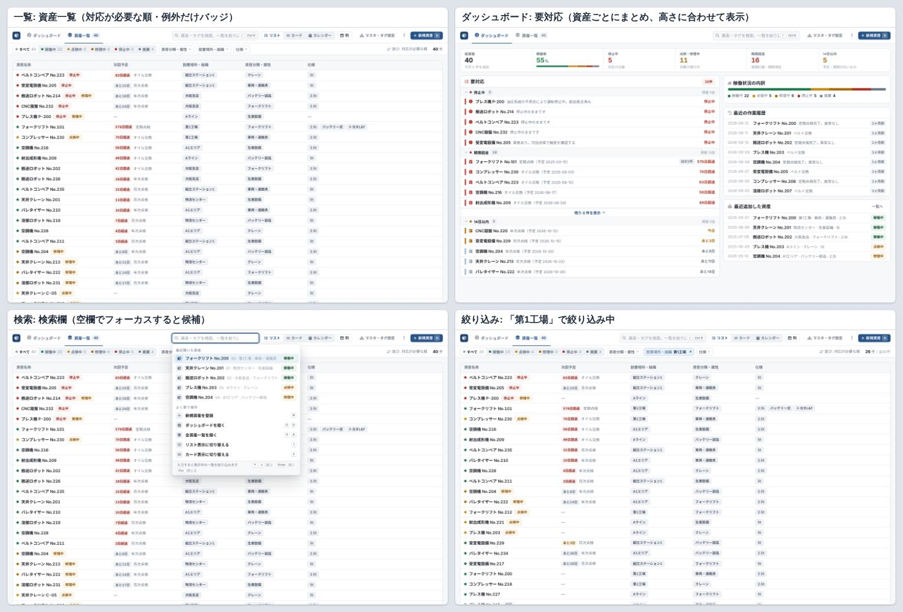

改善後（モバイル 390×844）: 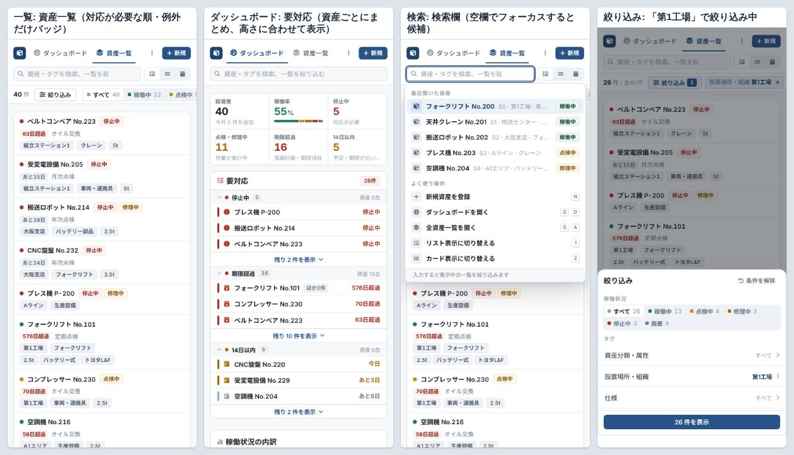

### 項目1: モバイルのヘッダーとフィルタバー

モバイル幅での問題のため、比較もモバイル幅で行った（デスクトップの表示は全案で変わらない）。

#### 1回目（5案 + 方向性の異なる2案）

| 案 | 内容 | 使 | わ | 直 | 汎 | 視 | 階 | 計 | 主な減点 |
| --- | --- | --: | --: | --: | --: | --: | --: | --: | --- |
| A0 | 現状（比較用） | 14 | 13 | 10 | 8 | 11 | 11 | 67 | マスタ別ボタンが画面外 |
| A1 | フィルタバーを2段（状態 / マスタ） | 16 | 16 | 13 | 11 | 12 | 9 | 77 | 上部が約165pxに増える |
| A2 | マスタを先頭・状態を後ろの1段＋右端フェード | 16 | 14 | 12 | 10 | 11 | 13 | 76 | 今度は状態が画面外に隠れる |
| A3 | 「絞り込み」ボタン1つ＋下から出るシート | 16 | 15 | 14 | 15 | 12 | 14 | 86 | 操作が1手増える |
| A4 | 稼働状況もドロップダウンにして4ボタンを折返し | 15 | 15 | 14 | 12 | 10 | 12 | 78 | 状態の色と件数が見えなくなる |
| A5 | 検索行に「絞り込み」を置き、条件がある時だけバーを出す | 16 | 14 | 13 | 15 | 11 | 12 | 81 | 件数バッジでヘッダーが3段になる |
| A6 | （別方向）下部タブバー＋上は検索1行 | 17 | 15 | 14 | 14 | 12 | 15 | 87 | デスクトップと操作体系が変わる |
| A7 | （別方向）検索欄を絞り込みの入口にする（全画面パネル） | 14 | 13 | 11 | 10 | 12 | 14 | 74 | 入口が見えない。タグが多いと破綻 |

最高87点（90点未満）→ 2回目へ。

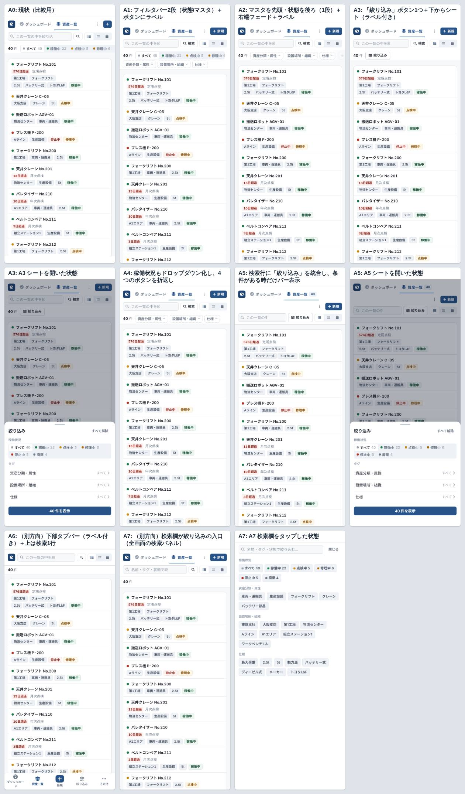

#### 2回目（上位3案 A6/A3/A5 ＋ 組合せ4案）

全案に「設置場所＝第1工場」を適用した状態で撮った。
A6/A3/A5 は、絞り込み中であることが画面に出ないため「わかりやすさ」を下げた。

| 案 | 内容 | 使 | わ | 直 | 汎 | 視 | 階 | 計 |
| --- | --- | --: | --: | --: | --: | --: | --: | --: |
| A6 | （1回目） | 17 | 13 | 14 | 14 | 12 | 15 | 85 |
| A3 | （1回目） | 16 | 13 | 14 | 15 | 12 | 14 | 84 |
| A5 | （1回目） | 16 | 12 | 13 | 15 | 11 | 12 | 79 |
| **B1** | A3＋状態セグメントは残す：［件数］［絞り込み n］［条件チップ］［状態］を1行 | 17 | 18 | 15 | 15 | 13 | 14 | **92** |
| B2 | A5改：検索行に［絞り込み n］、バーは件数＋条件チップ＋状態 | 16 | 18 | 15 | 15 | 13 | 14 | 91 |
| B3 | A6＋B1：下部タブ4つ＋上は検索1行＋B1のバー | 18 | 17 | 15 | 14 | 13 | 13 | 90 |
| B4 | A6＋A3：下部タブに「絞り込み」、上のバーは条件チップ＋状態 | 17 | 17 | 14 | 14 | 13 | 13 | 88 |

B3 は上部を43px減らせるが、下部タブバーに56pxを使うため縦の表示領域は増えない。

**決定: B1**（92点）。B2（91点）とは1点差だが、2回目で90点以上のため手順どおり決定した。

- 実装: 640px以下でマスタ別ボタンを「絞り込み」ボタン1つにまとめ、適用中の条件数をバッジで、
  タグ条件をチップで表示する。シートでマスタを選ぶとタグ階層ツリーへ進み、タグを選ぶとシートに戻る
- 「新規資産」は「新規」と短くしてラベル付きで表示する。検索ボタンにもラベルを付けた

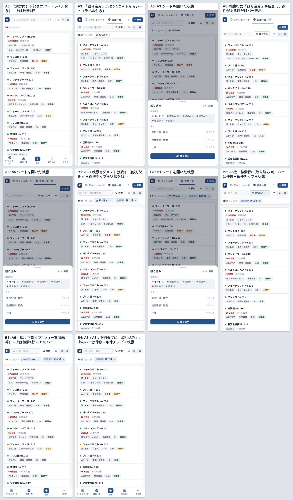

### 項目2: 検索の入口の統合

#### 1回目（5案 + 方向性の異なる2案）

すべて「フォーク」と入力した状態で撮った。

| 案 | 内容 | 使 | わ | 直 | 汎 | 視 | 階 | 計 | 主な減点 |
| --- | --- | --: | --: | --: | --: | --: | --: | --: | --- |
| S0 | 現状（一覧を絞り込む欄＋検索ボタン） | 15 | 12 | 10 | 13 | 11 | 12 | 73 | 2つの違いが分からない |
| S1 | 1つの欄に統合：入力で一覧を絞り込み、下に資産・タグ・操作の候補 | 17 | 16 | 14 | 15 | 12 | 15 | 89 | 候補が絞り込み結果を隠す |
| S2 | パレットに一本化：一覧の絞り込みはパレットから | 14 | 15 | 13 | 15 | 11 | 15 | 83 | 絞り込みに1手余分。モバイルでチップが画面外 |
| S3 | 一覧の欄に一本化：ボタンを消し、Ctrl K は欄内のヒントで案内 | 16 | 15 | 13 | 13 | 11 | 15 | 83 | ダッシュボードから検索が消える |
| S4 | 1つの欄＋範囲の切替［この一覧｜すべて］ | 15 | 16 | 13 | 13 | 11 | 13 | 81 | 切替の操作が増える |
| S5 | 一覧の絞り込み欄はフィルタバーへ、ヘッダーは全体検索の欄 | 15 | 15 | 13 | 11 | 11 | 12 | 77 | 欄が2つのまま。モバイルで画面外 |
| S6 | （別方向）キーワードもフィルタバーの条件ボタンの1つにする | 13 | 16 | 12 | 14 | 12 | 14 | 81 | 入力する場所が見えない |
| S7 | （別方向）表の見出し「資産名称」に絞り込み欄を埋め込む | 13 | 14 | 13 | 10 | 11 | 12 | 73 | 名前しか探せない。カード表示で使えない |

最高89点（90点未満）→ 2回目へ。

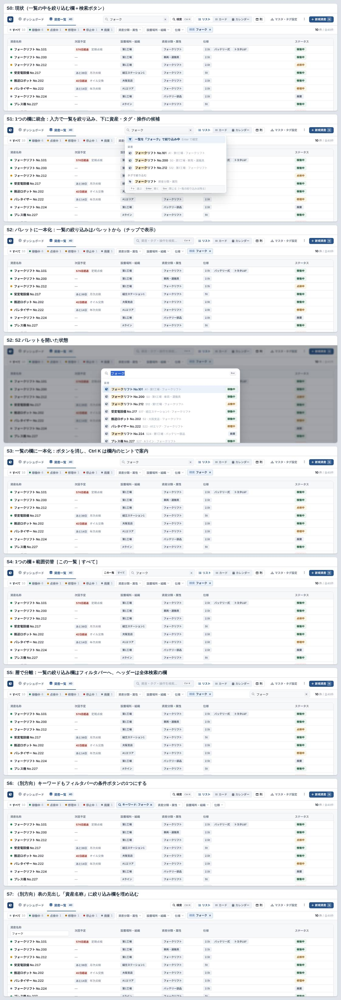

モバイル: 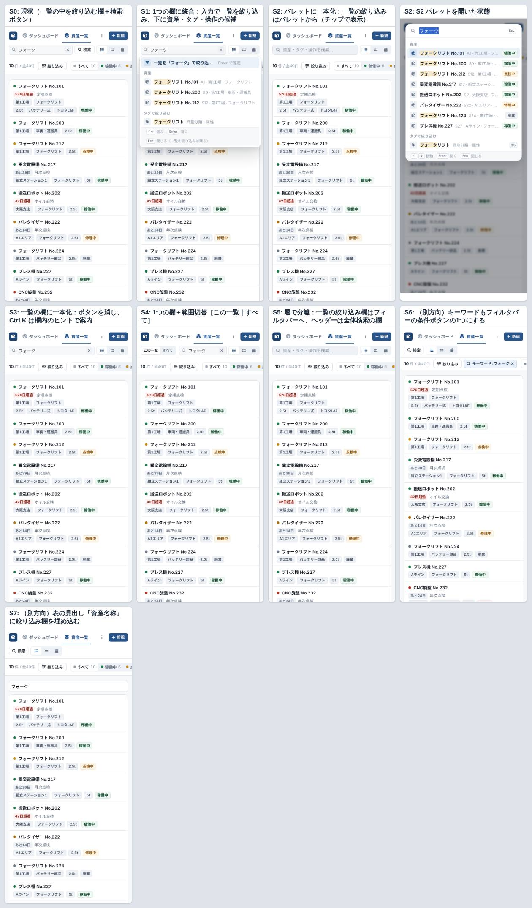

#### 2回目（上位3案 S1/S2/S3 ＋ 組合せ4案）

| 案 | 内容 | 使 | わ | 直 | 汎 | 視 | 階 | 計 |
| --- | --- | --: | --: | --: | --: | --: | --: | --: |
| S1 | （1回目） | | | | | | | 89 |
| S2 | （1回目） | | | | | | | 83 |
| S3 | （1回目） | | | | | | | 83 |
| T1 | S1改：候補を資産3件・タグ2件までの小さいドロップダウンにする | 17 | 17 | 15 | 15 | 12 | 15 | 91 |
| **T2** | S1＋S3：入力中は一覧だけを絞り込み、候補は空欄でフォーカスしたときと↓キーで出す | 18 | 17 | 14 | 15 | 12 | 15 | **91** |
| T4 | S1改：候補をドロップダウンでなく、一覧の上の1行に出す | 17 | 17 | 15 | 14 | 13 | 13 | 89 |
| T5 | S3＋S2：一覧では欄で絞り込み、ダッシュボードでは同じ欄でパレットを開く | 16 | 15 | 13 | 14 | 11 | 15 | 84 |

**決定: T2**（91点）。T1 と同点のため、配点の最も大きい「使いやすさ」で上回る T2 を選んだ
（入力中に候補が一覧を隠さない点が決め手）。

- 実装: ヘッダーの検索欄を全ページに出し、「検索 Ctrl K」ボタンを廃止。`Ctrl+K` と `/` はこの欄に移動する
- 評価時のモックに無かった部分の補い: ダッシュボードで入力すると資産一覧へ移って絞り込む。
  キーボードの無い端末では、フォーカス中の欄をもう一度タップすると入力中の語で候補を開く。
  モーダルの表示中は検索欄が隠れるため、`Ctrl+K` は従来のパレットで代用する
- 候補からタグを選ぶと、入力していた語での絞り込みは外して、そのタグで絞り込む

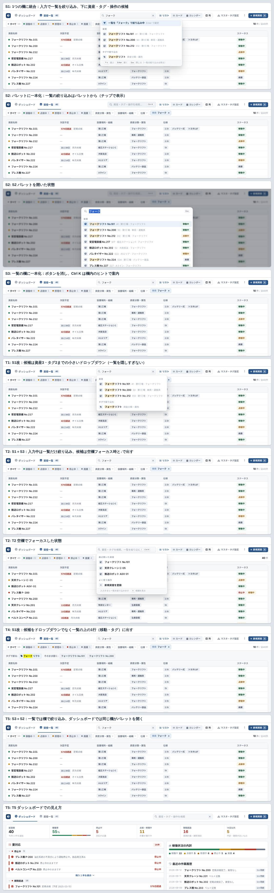

モバイル: 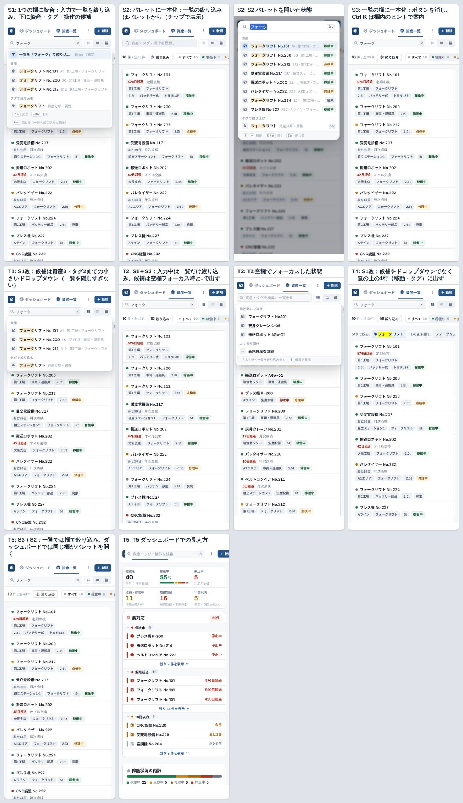

### 項目3: 資産一覧の状態表示と初期の並び

#### 1回目（5案 + 方向性の異なる2案）

| 案 | 内容 | 使 | わ | 直 | 汎 | 視 | 階 | 計 | 主な減点 |
| --- | --- | --: | --: | --: | --: | --: | --: | --: | --- |
| C0 | 現状（ドット＋ステータス列、登録順） | 14 | 13 | 12 | 12 | 12 | 11 | 74 | 二重表示、異常が上に来ない |
| C1 | ステータス列を外してドットに一本化＋対応が必要な順 | 17 | 15 | 13 | 14 | 13 | 15 | 87 | 状態名が文字で読めない |
| C2 | ドットを外し、ステータス列を名称の隣へ＋次回予定が近い順 | 16 | 16 | 14 | 13 | 12 | 13 | 84 | 予定の無い停止中が下に沈む |
| C3 | 名称の後ろに状態バッジ（列は外す）＋対応が必要な順＋区切り見出し | 17 | 18 | 15 | 14 | 13 | 14 | 91 | 稼働中にもバッジが付き、うるさい |
| C4 | 複数の状態は2色ドット＋ステータス列を外す＋次回予定が近い順 | 16 | 14 | 12 | 14 | 13 | 15 | 84 | 2色ドットの意味が読めない |
| C5 | 正常（稼働中）は無表示、異常だけ名称の後ろにバッジ＋対応が必要な順 | 18 | 18 | 14 | 15 | 14 | 15 | 94 | — |
| C6 | （別方向）状態ごとのセクションに分けて折りたたむ | 15 | 16 | 14 | 12 | 13 | 12 | 82 | 稼働中の期限超過が埋もれる |
| C7 | （別方向）行の背景色で異常を示す＋対応が必要な順 | 16 | 15 | 13 | 13 | 15 | 14 | 86 | 正常な行の状態が読めない |

1位94点・2位91点で3点差（僅差）→ 2回目へ。

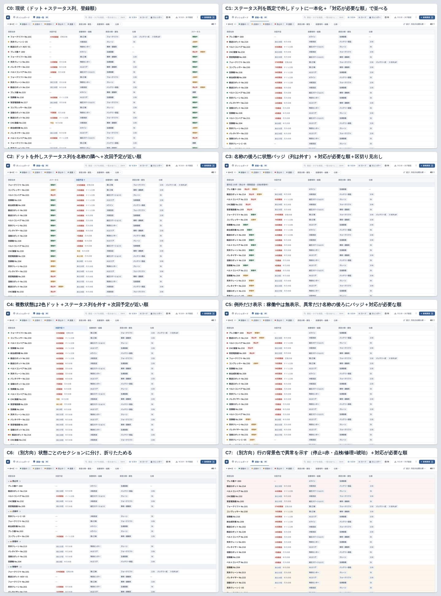

モバイル: 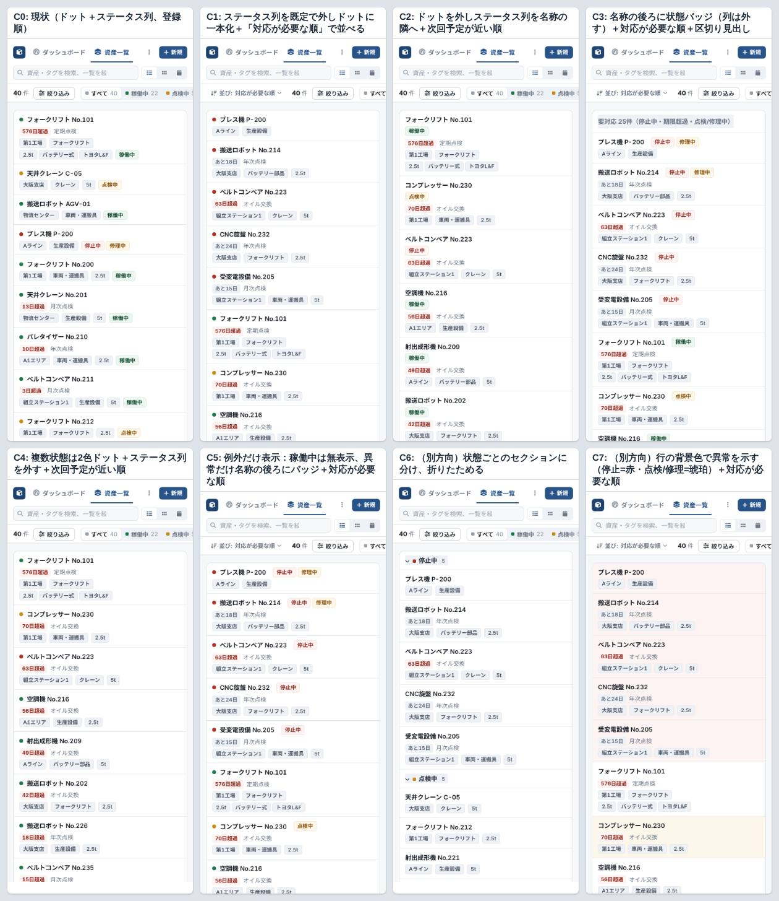

#### 2回目（上位3案 C5/C3/C1 ＋ 組合せ4案）

| 案 | 内容 | 使 | わ | 直 | 汎 | 視 | 階 | 計 |
| --- | --- | --: | --: | --: | --: | --: | --: | --: |
| C5 | （1回目） | | | | | | | 94 |
| C3 | （1回目） | | | | | | | 91 |
| C1 | （1回目） | | | | | | | 87 |
| D1 | C5＋区切り見出し（要対応 n件 / その他） | 18 | 19 | 15 | 15 | 14 | 14 | 95 |
| D2 | C5からドットも外す（異常はバッジだけ） | 18 | 17 | 14 | 15 | 13 | 15 | 92 |
| D3 | C5＋停止中の行だけ淡い赤の背景 | 18 | 18 | 14 | 14 | 15 | 15 | 94 |
| **D4** | C5＋廃棄（対象外）の行は文字を淡くして末尾へ | 18 | 18 | 15 | 15 | 15 | 15 | **96** |

D3 は停止中をドット・バッジ・背景の3重で示すことになり、ホバーやキーボード選択の行の色ともぶつかる。

**決定: D4**（96点）。

- 実装: ステータス列を既定で外す（列設定から戻せる。保存済みの設定でも1度だけ外す）。
  名称の後ろには正常以外の状態だけをバッジで出す
- 列の見出しで並べ替えていないときは「対応が必要な順」
  （停止中 → 期限超過 → 点検・修理中 → 14日以内 → その他 → 廃棄）。カード表示も同じ並び
- 並び順をフィルタバーに表示し、列で並べ替えたときは × で「対応が必要な順」に戻せる
- 状態の意味は `STATUS_DEFS` の `level`（ok / warn / stop / off）で持つため、状態を追加しても同じ規則で並ぶ

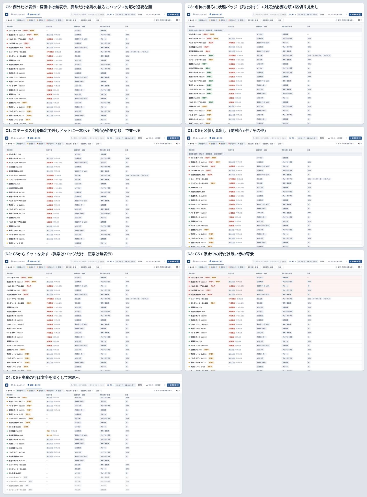

モバイル: 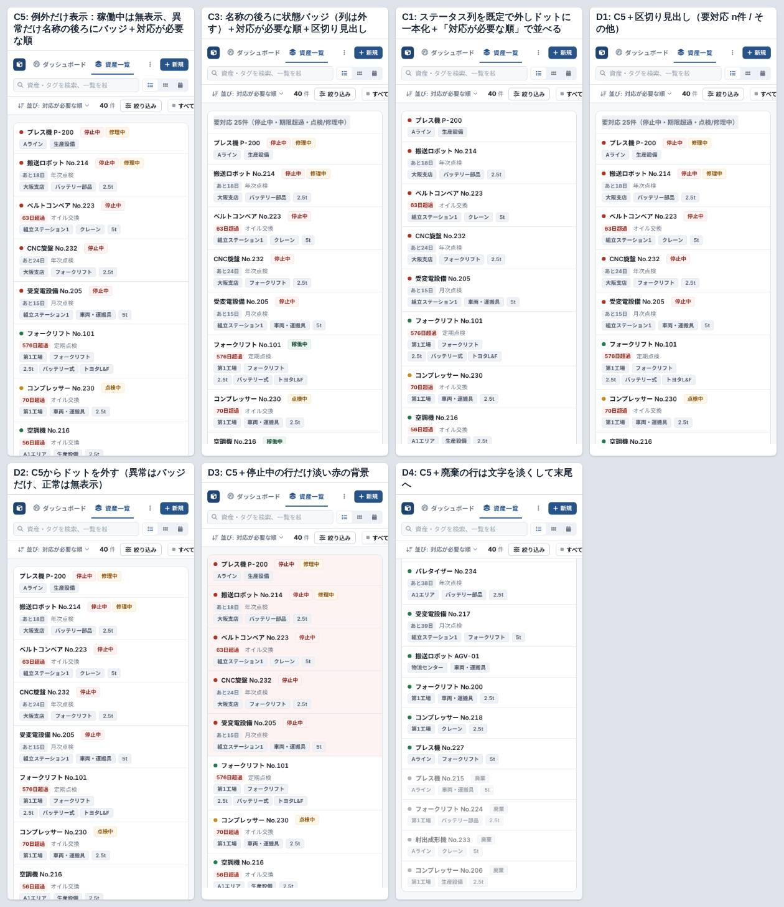

### 項目4: ダッシュボードの「要対応」

#### 1回目（5案 + 方向性の異なる2案）

| 案 | 内容 | 使 | わ | 直 | 汎 | 視 | 階 | 計 | 主な減点 |
| --- | --- | --: | --: | --: | --: | --: | --: | --: | --- |
| E0 | 現状（各グループ上位3件） | 15 | 14 | 14 | 11 | 13 | 12 | 79 | 同じ資産が並ぶ、下に空白 |
| E1 | 資産ごとに1行にまとめる（「ほか n件」）、上位3件 | 17 | 17 | 15 | 14 | 13 | 13 | 89 | 下の空白は残る |
| E2 | 画面の高さに収まるだけ表示（まとめない） | 17 | 15 | 15 | 13 | 13 | 15 | 88 | 同じ資産が並ぶ |
| **E3** | E1＋E2：資産ごとにまとめ、画面の高さに収まるだけ表示 | 18 | 18 | 15 | 15 | 13 | 15 | **94** | — |
| E4 | グループをやめ、資産1行・課題をラベルで並べた1本のリスト | 17 | 16 | 14 | 14 | 14 | 14 | 89 | 種別の区切りが消え、縦に長い |
| E5 | 3列のカンバン（停止中 / 期限超過 / 14日以内） | 15 | 16 | 15 | 11 | 14 | 12 | 83 | 列が狭く内容が切れる |
| E6 | （別方向）要対応を全幅の表にし、補助情報は下段へ | 15 | 15 | 14 | 10 | 12 | 13 | 79 | モバイルで表が崩れる |
| E7 | （別方向）要対応の資産をカードで並べる | 15 | 16 | 15 | 13 | 15 | 12 | 86 | 密度が下がる |

1回目で90点以上、2位と5点差 → **決定: E3**（94点）。

- 実装: 同じ資産の課題は最も急ぐものを代表にして1行にまとめ、残りは「ほか n件」（内容はツールチップ）。
  グループ見出しに「資産 n台」を出す。「実施済み」は代表の課題に対して行う
- 表示件数は画面の高さから決め、各グループ3〜8件にする（1列表示になる幅1100px以下では3件）。
  画面の高さが変わったときは描き直す

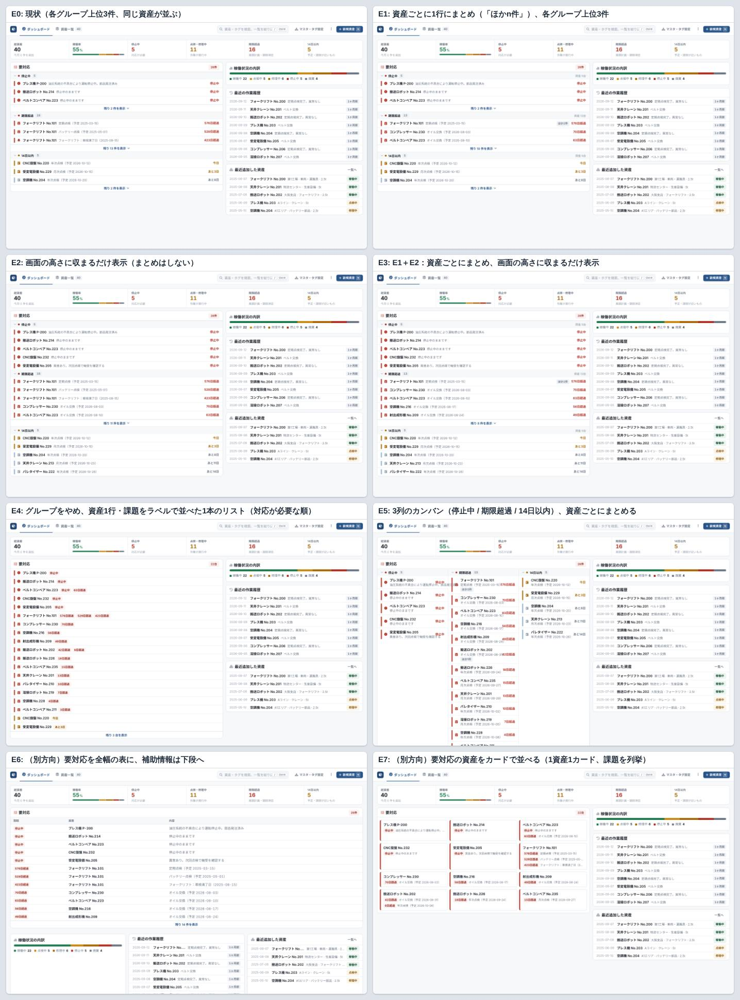

モバイル: 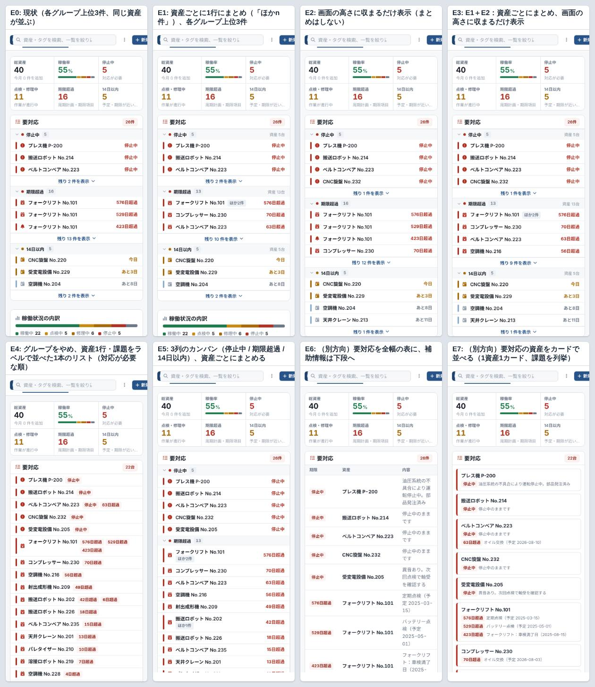

### 実装後の再評価

| 観点 | v3.0.0 | v3.1.0 | 変わった点 |
| --- | --: | --: | --- |
| 使いやすさ | 16 | 18 | 検索の入口が1つになった。開いてすぐ停止中・期限超過が上に並ぶ |
| わかりやすさ | 16 | 18 | 状態の二重表示がなくなった。モバイルでも絞り込み中の条件が見える |
| 直感性 | 12 | 14 | モバイルのボタンにラベルを付けた。並び順を画面に表示した |
| 汎用性 | 11 | 14 | マスタが増えてもモバイルの絞り込みが破綻しない。状態の意味を `level` で一般化した |
| 視覚表現 | 12 | 13 | 異常だけに色が付き、廃棄は淡く表示する |
| 階層構造化 | 12 | 14 | 要対応が画面の高さを使い切る。状態列の分の幅を他の列に回せた |
| **合計** | **79** | **91** | |

残る課題（今回の対象外）:

- ~~モバイルの表示切替（リスト / カード / カレンダー）と「⋮」はアイコンだけのまま~~ → v3.2.0 で対応
- 同点のときの決め方が `CLAUDE.md` に無い（今回は配点の大きい観点から順に比べて決めた）

---

## v3.0.0 — UI/UX 全面見直し

`CLAUDE.md` の「UI/UX 改修の進め方」に沿って、5つの改修項目それぞれで案を比較し、
スコアで1案に決めてから実装した記録です。

- 各案は実際のアプリにCSS/JSの差分として注入し、同じデータ（資産40件）・同じ画面幅
  （1440×900 / モバイル 390×844）でキャプチャしてから採点しています。
- 配点: 使いやすさ20 / わかりやすさ20 / 直感性15 / 汎用性15 / 視覚表現15 / 階層構造化15（計100）
- 表の列: 使=使いやすさ / わ=わかりやすさ / 直=直感性 / 汎=汎用性 / 視=視覚表現 / 階=階層構造化

### 改修前の主な問題

| 問題 | 影響 |
| --- | --- |
| 左サイドバー（250px）にタグ階層ツリーとよく使う絞り込みが常時展開 | 一覧の表示領域を常に圧迫。サブ情報が主役を食っていた |
| 一覧が `max-height: calc(100vh - 230px)` の内部スクロール | 40件中19行しか見えず、下部は空白 |
| 次回予定の算出が「今日以降」のみ | **期限超過の予定が一覧から消える**（最も対応が必要なものが見えない） |
| タグがすべて同じ灰色バッジ、状態は右端の列のみ | 行を左から読んだときに異常に気づけない |
| モバイルで一覧が横スクロールの表 | 資産名が切れて何の行か分からない |
| 資産詳細が7タブ（運用・リスクは各テキスト欄2つだけ） | 中身の薄いタブを行き来する必要がある |
| ダッシュボードの要対応が最大12行の1リスト | 種類が混在し、件数が増えると画面を占領 |
| マスタ編集が入れ子の箱 | 階層が深いほど横幅が削られ、7階層目は名前が収まらない |

| 改修前 | 改修後 |
| --- | --- |
| 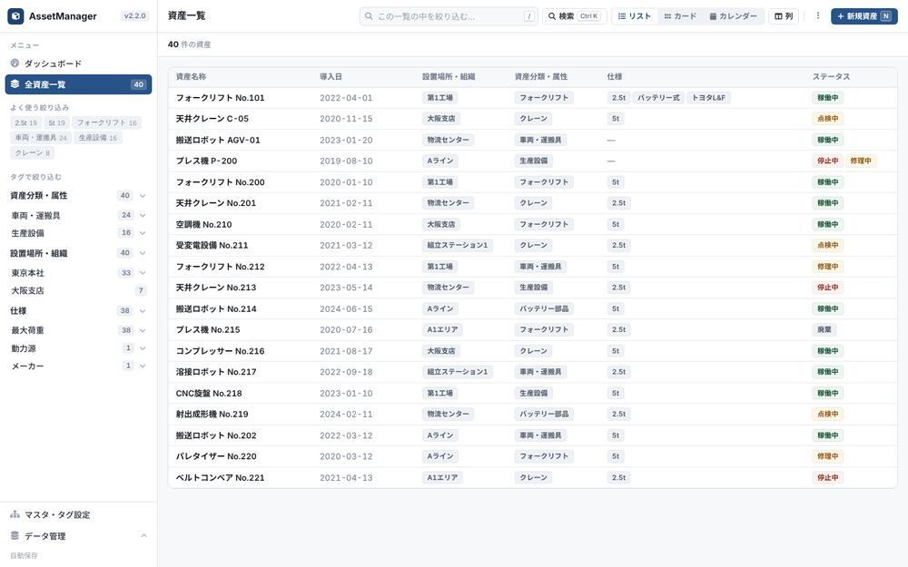 | 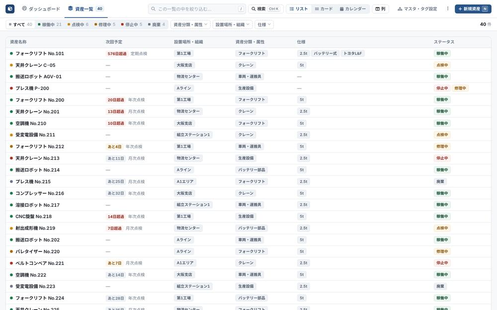 |
| 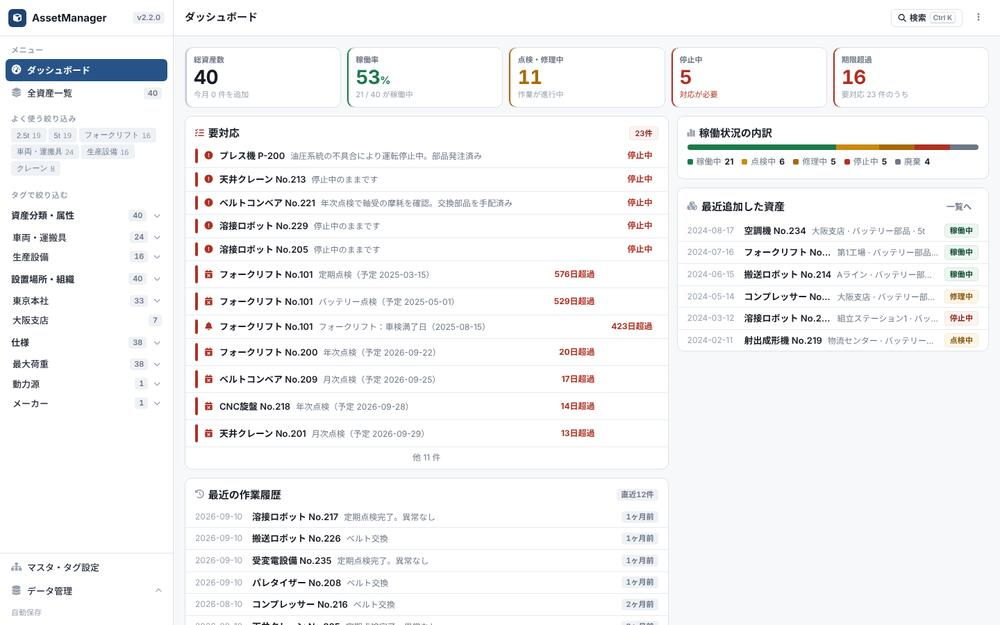 | 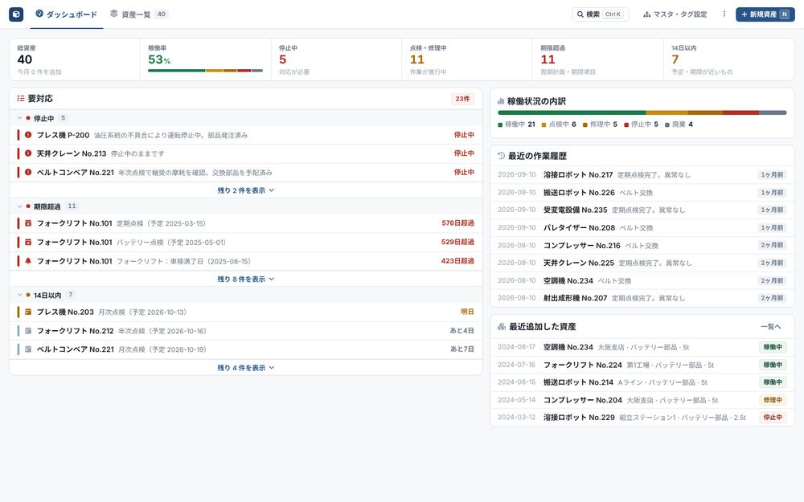 |

モバイル（改修後）: 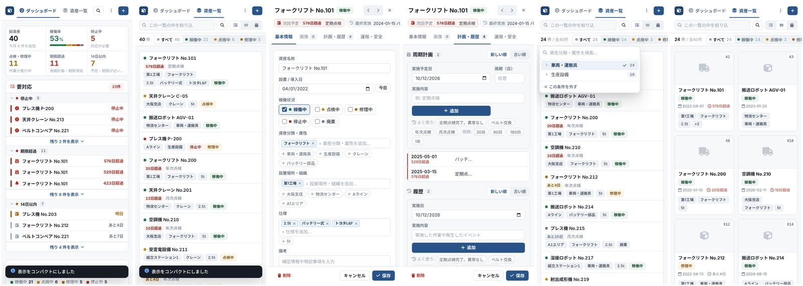

---

### 項目1: アプリシェル（ナビゲーションと絞り込みの配置）

#### 1回目（5案 + 方向性の異なる2案）

| 案 | 内容 | 使 | わ | 直 | 汎 | 視 | 階 | 計 |
| --- | --- | --: | --: | --: | --: | --: | --: | --: |
| 1A | アイコンレール(56px)＋絞り込みフライアウト | 15 | 14 | 12 | 13 | 11 | 14 | 79 |
| 1B | サイドバー縮小(208px)＋マスタ初期折りたたみ | 16 | 16 | 14 | 12 | 11 | 11 | 80 |
| **1C** | サイドバー廃止：トップタブ＋マスタ別ドロップダウン | 17 | 17 | 14 | 11 | 12 | 14 | **85** |
| 1D | アイコンレール＋一覧内ファセットペイン | 16 | 16 | 14 | 13 | 12 | 12 | 83 |
| 1E | サイドバー開閉トグル（閉じた状態） | 12 | 13 | 11 | 13 | 10 | 15 | 74 |
| 1F | （別方向）検索中心：「絞り込みを追加」＋チップ | 15 | 14 | 12 | 15 | 11 | 15 | 82 |
| 1G | （別方向）右スライドオーバーの絞り込みパネル | 14 | 15 | 13 | 14 | 11 | 14 | 81 |

最高85点（90点未満）→ 2回目へ。

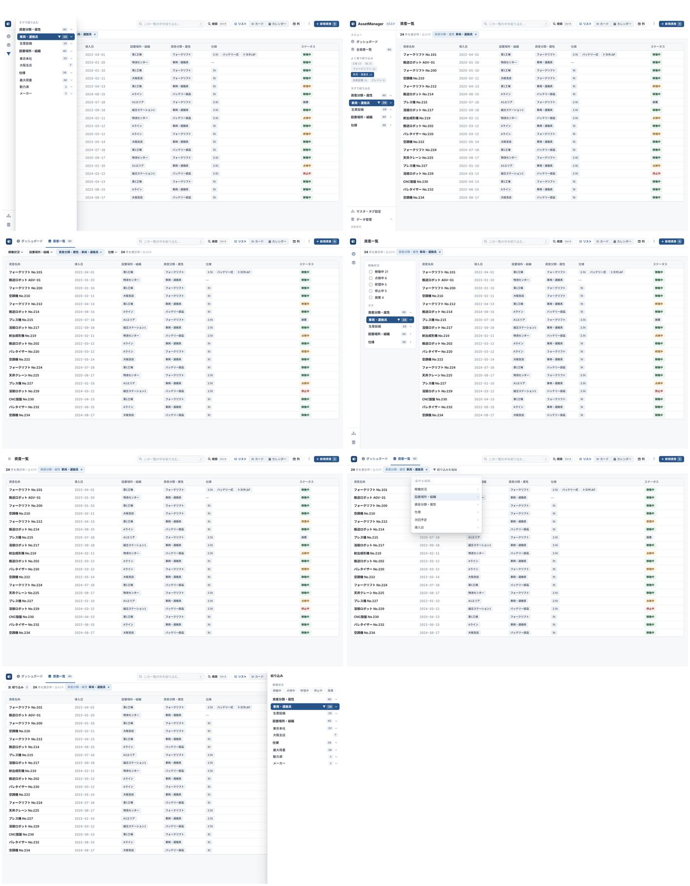

#### 2回目（上位3案 1C/1D/1F ＋ 組合せ4案）

抽出したエッセンス: 「全幅の一覧（1C）」「状態はファセットで常時見せる（1D）」「マスタ数に依存しない追加型（1F）」

| 案 | 内容 | 使 | わ | 直 | 汎 | 視 | 階 | 計 |
| --- | --- | --: | --: | --: | --: | --: | --: | --: |
| 1C | （1回目） | | | | | | | 85 |
| 1D | （1回目） | | | | | | | 83 |
| 1F | （1回目） | | | | | | | 82 |
| 2H | トップタブ＋状態セグメント(色)＋マスタ別ドロップダウン | 18 | 17 | 15 | 12 | 14 | 12 | 88 |
| 2I | トップタブ＋開閉式ファセットペイン | 16 | 17 | 15 | 14 | 13 | 12 | 87 |
| 2J | ラベル付き細レール＋状態セグメント＋ドロップダウン | 18 | 17 | 16 | 14 | 14 | 13 | 92 |
| **2K** | トップタブ＋状態セグメント＋ドロップダウン内ツリー（件数・検索・よく使う） | 19 | 17 | 16 | 14 | 14 | 13 | **93** |

**決定: 2K**（93点）。実装時の補正: モックで状態セグメントと重複していた「稼働状況」ドロップダウンは削除。
モバイルではフィルタバーを折り返さず横スクロールにして縦の表示領域を守る。

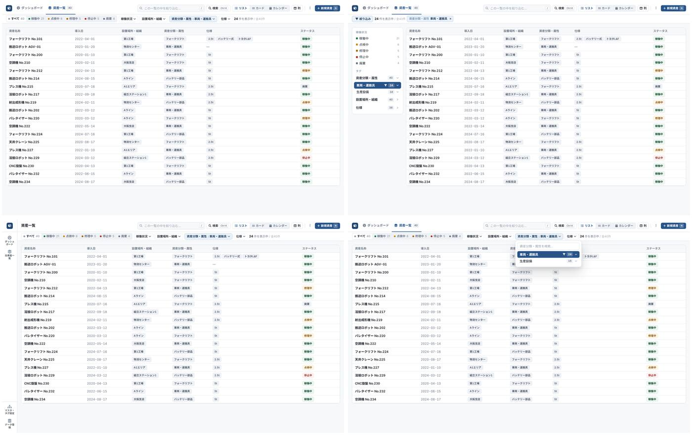

---

### 項目2: 資産一覧（リスト表示）

| 案 | 内容 | 使 | わ | 直 | 汎 | 視 | 階 | 計 |
| --- | --- | --: | --: | --: | --: | --: | --: | --: |
| L1 | 全高表示＋状態を名称左の色ドット | 16 | 16 | 14 | 11 | 13 | 13 | 83 |
| L2 | マスタ別のタグ色＋階層パス | 15 | 17 | 14 | 11 | 14 | 12 | 83 |
| L3 | 次回予定列（期限を色で可視化） | 17 | 17 | 14 | 11 | 15 | 13 | 87 |
| L4 | 設置場所でグループ化 | 15 | 15 | 14 | 11 | 12 | 12 | 79 |
| L5 | 2行の行（名称＋タグ）で列を削減 | 14 | 15 | 14 | 13 | 11 | 11 | 78 |
| L6 | （別方向）分割ビュー：右に詳細プレビュー | 16 | 16 | 15 | 10 | 13 | 12 | 82 |
| **L7** | （別方向）状態ドット＋次回予定＋狭幅でカード行に自動変換 | 17 | 17 | 15 | 15 | 14 | 14 | **92** |

1回目で90点以上、2位と5点差（僅差ではない）→ **決定: L7**。

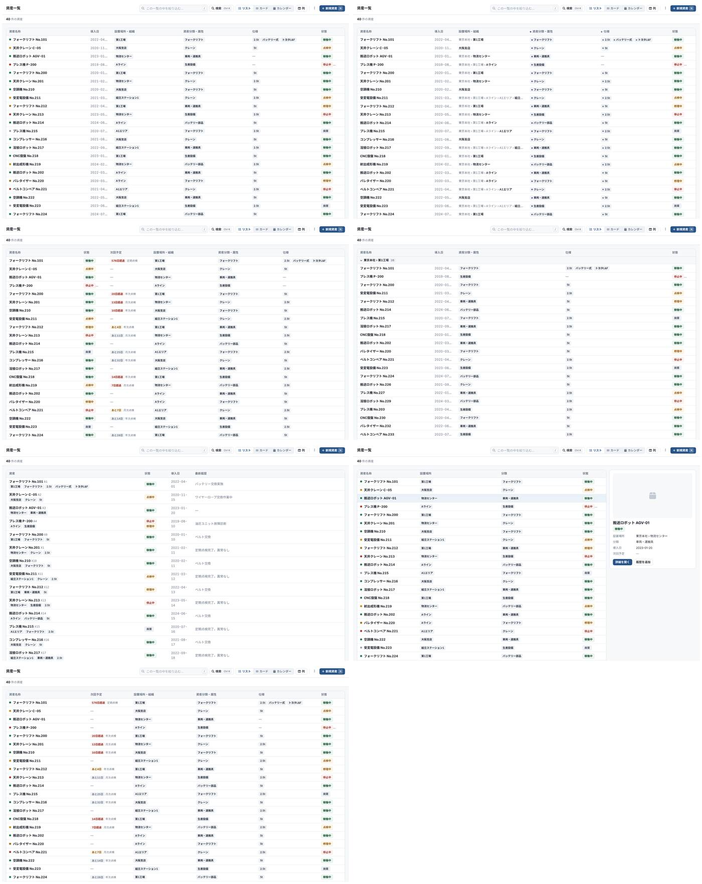

---

### 項目3: ダッシュボード

| 案 | 内容 | 使 | わ | 直 | 汎 | 視 | 階 | 計 |
| --- | --- | --: | --: | --: | --: | --: | --: | --: |
| D1 | KPIを1行ストリップに圧縮＋要対応を全幅 | 17 | 16 | 15 | 14 | 12 | 15 | 89 |
| D2 | 要対応を3列カンバン | 16 | 18 | 16 | 12 | 13 | 13 | 88 |
| D3 | ドーナツ＋KPI統合（左）＋要対応（右） | 15 | 15 | 14 | 13 | 15 | 12 | 84 |
| D4 | 今後30日のタイムライン帯＋要対応 | 15 | 15 | 13 | 13 | 15 | 12 | 83 |
| **D5** | KPIストリップ＋要対応を種別グループ化（各上位3件＋すべて表示） | 17 | 18 | 15 | 15 | 13 | 15 | **93** |
| D6 | （別方向）設置場所×状態のヒートマップ | 14 | 15 | 12 | 11 | 16 | 12 | 80 |
| D7 | （別方向）今日のタスク・チェックリスト中心 | 14 | 15 | 16 | 13 | 10 | 13 | 81 |

1回目で90点以上、2位と4点差 → **決定: D5**。

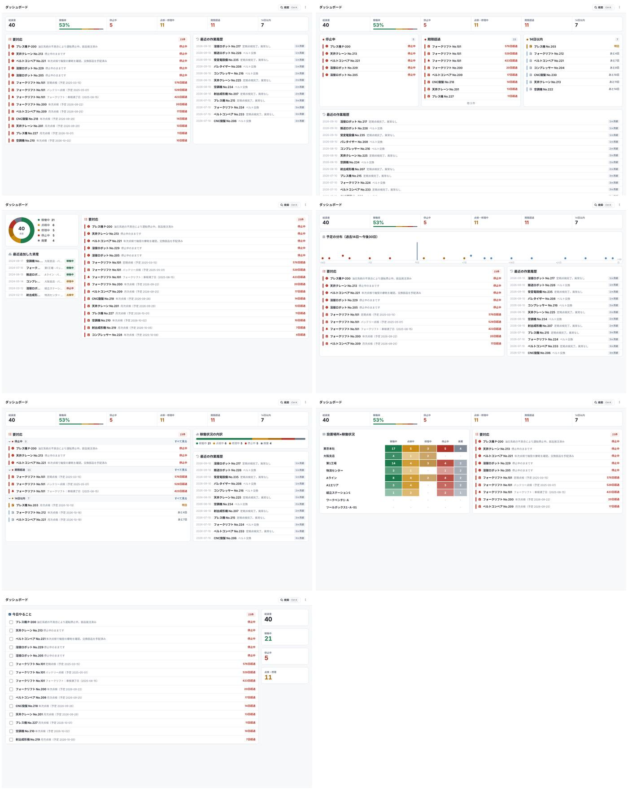

---

### 項目4: 資産詳細モーダル

#### 1回目

| 案 | 内容 | 使 | わ | 直 | 汎 | 視 | 階 | 計 |
| --- | --- | --: | --: | --: | --: | --: | --: | --: |
| **M1** | タブを7→4に統合 | 17 | 16 | 15 | 15 | 11 | 14 | **88** |
| M2 | 左サマリーパネル＋右タブ | 16 | 17 | 15 | 11 | 14 | 12 | 85 |
| M3 | 縦タブ（左ナビ） | 15 | 15 | 15 | 12 | 11 | 12 | 80 |
| M4 | 1ページスクロール＋目次 | 14 | 14 | 14 | 13 | 10 | 11 | 76 |
| **M5** | ヘッダーにサマリーチップ | 16 | 17 | 15 | 14 | 13 | 13 | **88** |
| M6 | （別方向）右ドロワー | 15 | 14 | 14 | 12 | 11 | 13 | 79 |
| M7 | （別方向）閲覧モード＋編集ボタン | 14 | 16 | 13 | 12 | 12 | 12 | 79 |

最高88点・1位同点 → 2回目へ。

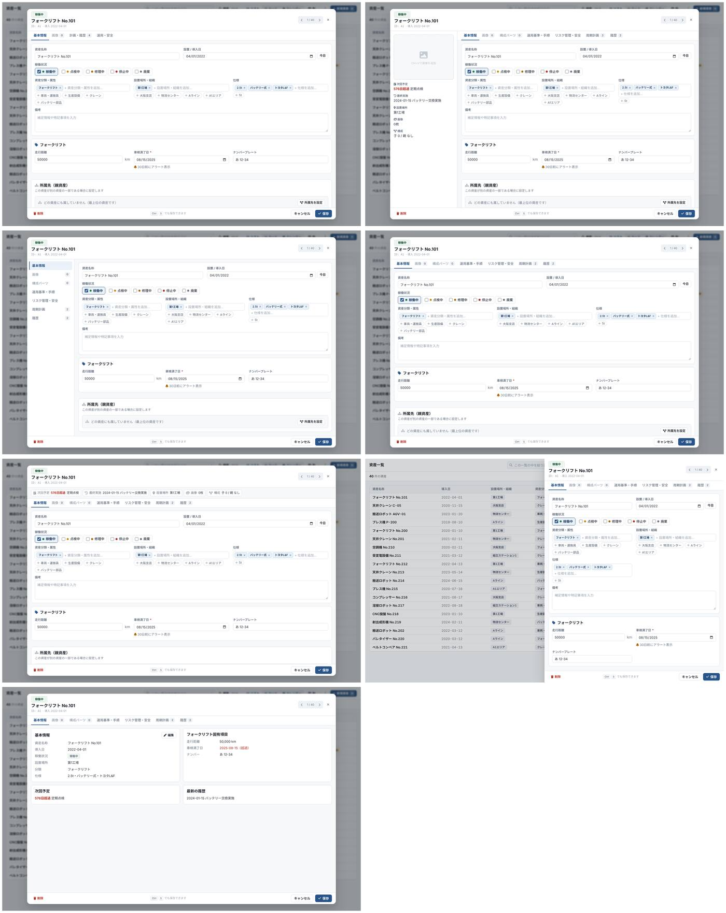

#### 2回目（上位3案 M1/M5/M2 ＋ 組合せ4案）

| 案 | 内容 | 使 | わ | 直 | 汎 | 視 | 階 | 計 |
| --- | --- | --: | --: | --: | --: | --: | --: | --: |
| N1 | 4タブ＋サマリーチップ行 | 17 | 18 | 15 | 15 | 13 | 14 | 92 |
| N2 | N1＋タイトル行に状態を統合（見出しを1段圧縮） | 18 | 18 | 16 | 15 | 13 | 15 | 95 |
| N3 | 4タブ＋右サマリー列（広い画面のみ） | 16 | 17 | 15 | 13 | 13 | 12 | 86 |
| **N4** | N2＋「計画・履歴」タブで予定と実績を左右に並べる | 19 | 18 | 16 | 14 | 14 | 15 | **96** |

**決定: N4**（96点）。狭い画面では計画と履歴を縦に積む。

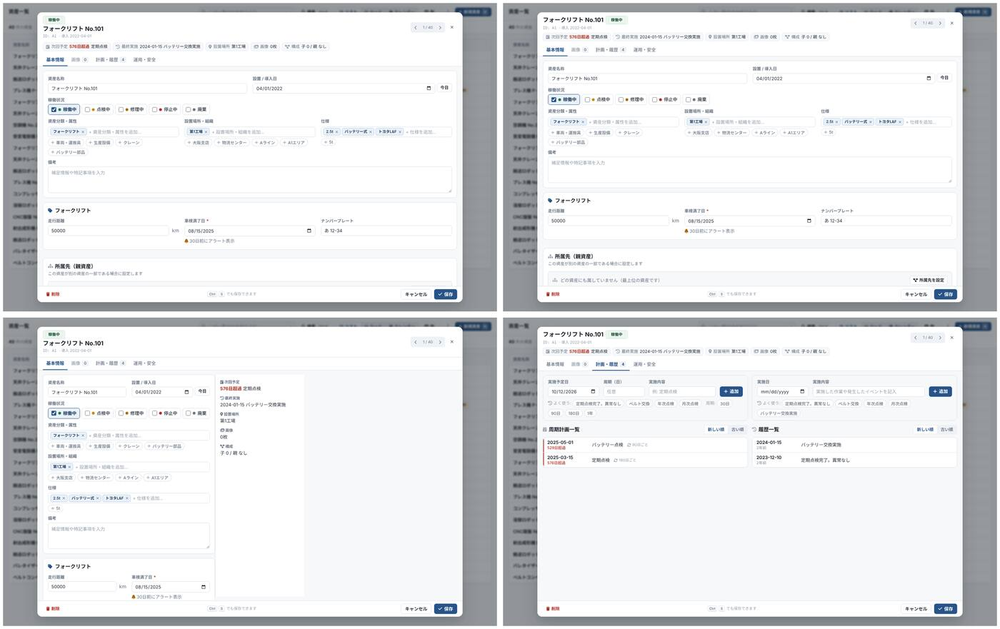

---

### 項目5: マスタ管理（タグ階層エディタ）

#### 1回目

| 案 | 内容 | 使 | わ | 直 | 汎 | 視 | 階 | 計 |
| --- | --- | --: | --: | --: | --: | --: | --: | --: |
| **T1** | ツリー行（罫線ガイド・インデント小） | 17 | 17 | 16 | 15 | 12 | 15 | **92** |
| T2 | カラムビュー（Finder型） | 14 | 15 | 13 | 11 | 12 | 13 | 78 |
| T3 | テーブル（名称/パス/資産数/固有項目） | 15 | 16 | 14 | 12 | 11 | 12 | 80 |
| T4 | 入れ子の箱を維持＋インデント縮小 | 14 | 14 | 14 | 12 | 11 | 12 | 77 |
| T5 | アウトライナー＋選択タグの詳細ペイン | 17 | 17 | 15 | 13 | 13 | 14 | 89 |
| T6 | （別方向）パンくずドリルダウン | 12 | 13 | 13 | 15 | 10 | 13 | 76 |
| T7 | （別方向）グラフビューを既定に | 12 | 12 | 11 | 10 | 15 | 10 | 70 |

1位92点・2位89点で3点差（僅差）→ 2回目へ。モバイルでは左のマスタ一覧が幅を奪うことも判明。

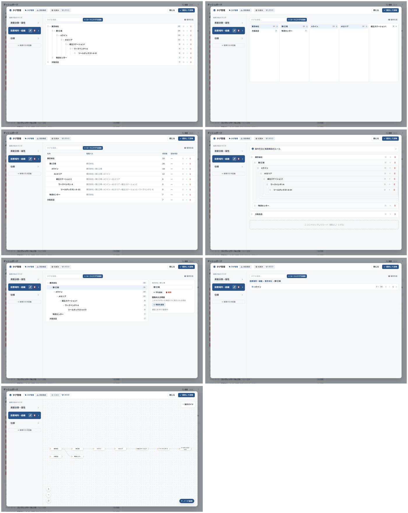

#### 2回目（上位3案 T1/T5/T3 ＋ 組合せ4案）

| 案 | 内容 | 使 | わ | 直 | 汎 | 視 | 階 | 計 |
| --- | --- | --: | --: | --: | --: | --: | --: | --: |
| U1 | ツリー行＋マスタ切替を上部タブ化 | 18 | 17 | 16 | 16 | 12 | 16 | 95 |
| U2 | U1＋選択タグの詳細ペイン | 18 | 18 | 16 | 15 | 13 | 15 | 95 |
| **U3** | U1＋資産数・固有項目数のバッジ | 18 | 18 | 16 | 16 | 13 | 16 | **97** |
| U4 | U1＋深さ別の色付きガイド線＋行内「子を追加」 | 17 | 17 | 15 | 15 | 13 | 15 | 92 |

**決定: U3**（97点）。固有項目の編集は既存の右ペインをそのまま使う。

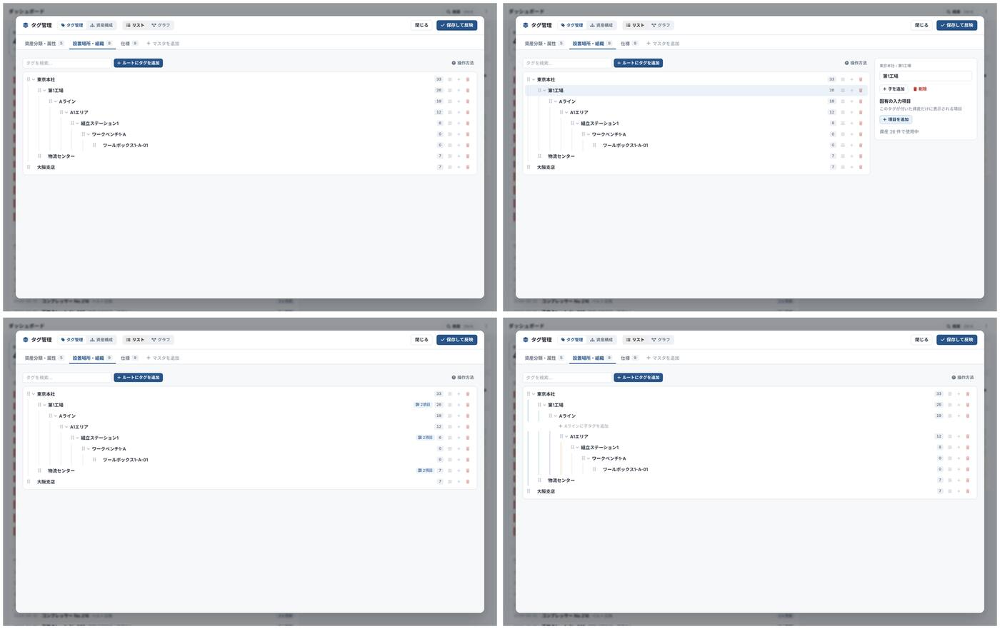
